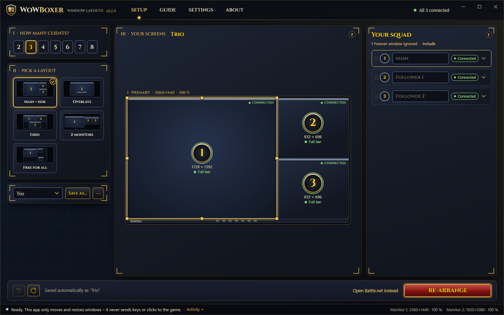

# WoWBoxer Window Layouts

Free, open-source (MIT) Windows app for **manual** World of Warcraft multiboxing.
It opens your WoW clients and places 1–8 game windows in a layout you choose, on one monitor or several, and keeps
them there.



## What it does, and what it never does

**It only moves, resizes and restyles windows** – and, only if you switch it on, Windows' own hover-to-activate setting.

| It does | It never does |
|---|---|
| Find WoW windows by their process and install folder | Send keystrokes or mouse clicks to the game |
| Move and resize them into your layout, without stealing focus | Broadcast input, round-robin or switch focus with hotkeys |
| Keep a window "always on top" if you ask | Read or write game memory, inject code or hook input |
| Open the login screens of the clients you are missing (you press Play) | Log in for you or store passwords |
| Optionally set WoW's UI Scale in `Config.wtf` so the action bar fits (with a backup) | Send telemetry. The update check is its only network call |
| Turn Windows' "activate a window by hovering over it" on or off for you, with a delay – the WoWBoxer way to switch windows. Off by default, your own values kept | Change any Windows setting without your click |

**Compliance.** Blizzard allows multiboxing as long as every action in the game comes from one key press or click
of yours on one character. Since 2022 it no longer allows software that broadcasts input to several clients. This
app is built to stay inside that line: it never touches input at all, so you play each character yourself. Using it
is still your own responsibility. Check Blizzard's current rules for the game you play.

## Install

1. Download **[WoWBoxer-Setup.exe](https://github.com/WoW-Multiboxing/wowboxer-layouts/releases/latest/download/WoWBoxer-Setup.exe)**
   (always the newest version) and run it.
2. It installs for your Windows user only, so **no admin rights** are needed. If the
   [.NET 10 Desktop Runtime](https://dotnet.microsoft.com/download/dotnet/10.0) is missing, Setup downloads and
   installs it from Microsoft first. That one step shows a Windows permission prompt, because the runtime is shared
   by all users.
3. The app updates itself from GitHub Releases (the update installs when you quit the app). You can switch this off
   in Settings.

Other downloads on the [Releases page](https://github.com/WoW-Multiboxing/wowboxer-layouts/releases):
`WoWBoxer-Portable.zip` (no install, no auto-update) and `SHA256SUMS.txt` to check your download
(`Get-FileHash WoWBoxer-Setup.exe -Algorithm SHA256` in PowerShell).
Uninstall from Windows Settings → Apps. Your layouts stay in `%APPDATA%\WoWBoxer`.

> **Windows SmartScreen** may say "Windows protected your PC" because the files are not code-signed yet
> (we have applied for free signing from SignPath Foundation, see [code signing](docs/code-signing-policy.md)).
> Click *More info* → *Run anyway*, or check the file against `SHA256SUMS.txt` first.

## Using it

- **Setup** – how many clients (1–8), pick a layout card (Main + side, Overlays, Grid, 2 monitors, Free for all),
  then fine-tune on a to-scale map of your monitors: drag, resize, snap, nudge, undo. One button opens the missing
  clients; new WoW windows drop into the next free slot by themselves. Layouts save automatically; share them as
  `WBX1:` codes or files, or capture an arrangement you made by hand.
- **Guide** – WoW display settings, switching windows, troubleshooting.
- **Settings** – window rules, action bar (UI Scale), titles, tools (Identify, Diagnose, title bars back), shortcut,
  updates.
- **Start / Stop placing windows** (main screen and tray). The app opens stopped, so it never touches the windows of
  another game until you press Start. A desktop shortcut starts a layout in one click.

Tips:
- Set WoW's Display Mode to **Windowed**. Title bars stay on by default (removing them made WoW draw its UI at the
  wrong size in our tests).
- Classic Era's action bar is only complete when a window is **4:3 or wider** at the UI Scale you use; *Auto-fit
  action bar* handles that. Details: [docs/wow-display-findings.md](docs/wow-display-findings.md).
- If windows do not move, Battle.net or WoW probably runs as administrator. Start them normally; Diagnose tells you.

## Command line (`wbx`)

The same engine without a window, and our test harness. Installed next to the app.

```
wbx start      start Battle.net, then place each WoW window as it opens (you press Play yourself)
wbx arrange    place the WoW windows that are open now, oldest first
wbx diagnose   write a report (monitors, windows, processes, admin rights, Config.wtf) and try one placement
wbx info       show monitors, the planned slots, the open WoW windows and the size each renders at
wbx capture    save the current window arrangement as a layout:  wbx capture --save my.json
wbx snap       save a picture of what each WoW window shows (read-only)
wbx restore    give WoW windows their title bars back
wbx layout     print a layout as JSON and as a WBX1: share code
```

Examples: `wbx arrange --preset grid`, `wbx start --profile my.json --names Paladin,Priest,Warlock`,
`wbx arrange --preset dual --clients 5`. Run `wbx help` for every option.

## Build from source

Needs Windows 10/11 and the [.NET 10 SDK](https://dotnet.microsoft.com/download/dotnet/10.0) (version pinned in
`global.json`).

```
git clone https://github.com/WoW-Multiboxing/wowboxer-layouts.git
cd wowboxer-layouts
dotnet build WoWBoxer.Layouts.slnx
dotnet test WoWBoxer.Layouts.slnx
dotnet run --project src/WoWBoxer.Layouts.App
```

A copy run from source never updates itself. Layout of the code: `src/WoWBoxer.Layouts.Core` (layout maths, no
Windows calls, fully unit-tested), `src/WoWBoxer.Layouts.Win32` (finding and placing windows), `src/WoWBoxer.Layouts.App`
(WPF app), `src/WoWBoxer.Layouts.Cli` (`wbx`). Plan and design notes: [docs/plan.md](docs/plan.md).
Releases: [docs/releasing.md](docs/releasing.md).

## Contributing, security, privacy

- [CONTRIBUTING.md](CONTRIBUTING.md) – bug reports, pull requests, the hard rules every change must keep.
- [SECURITY.md](SECURITY.md) – how to report a vulnerability privately.
- [docs/privacy.md](docs/privacy.md) – no telemetry; what stays on your PC.
- [CODE_OF_CONDUCT.md](CODE_OF_CONDUCT.md).

## Licence and trademarks

MIT – see [LICENSE](LICENSE). Third-party parts: [docs/third-party.md](docs/third-party.md).

World of Warcraft® and Battle.net® are trademarks or registered trademarks of Blizzard Entertainment, Inc. in the U.S.
and/or other countries. WoWBoxer is an independent fan project. It is not affiliated with, endorsed, sponsored or
approved by Blizzard Entertainment, and it uses no Blizzard art, logos or code.
